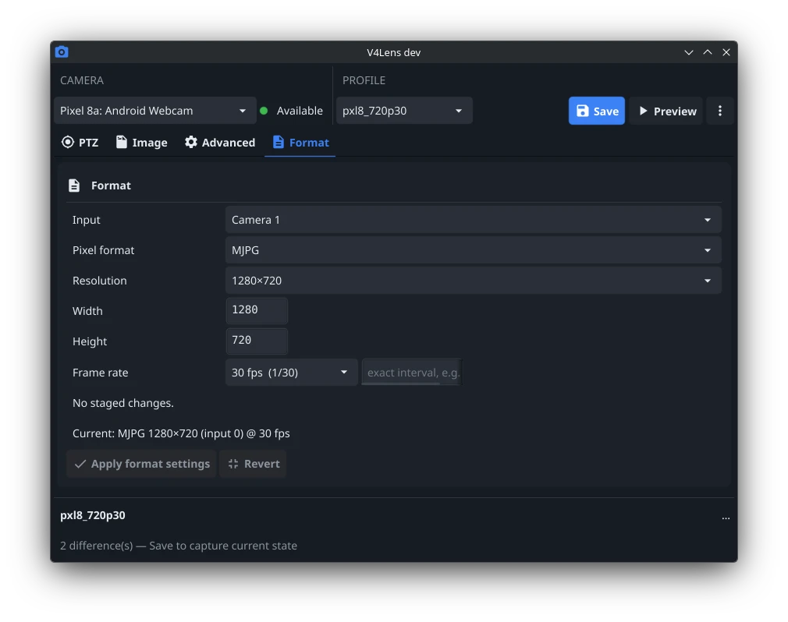
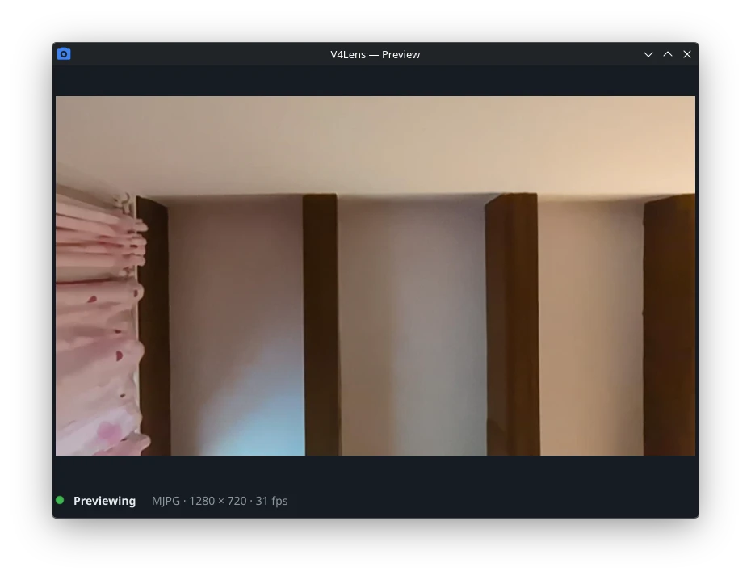

# V4Lens

A small Linux desktop utility for V4L2 cameras and capture devices. V4Lens makes common camera controls easier to use than qv4l2 while preserving access to unfamiliar and vendor-specific controls instead of hiding them.

It runs as a resident tray application: your camera settings and profiles stay available in the background, and launching it again just raises the existing window.

| Main window (Format tab) | Preview |
|---|---|
|  |  |

## Features

- **Live control changes** — sliders, checkboxes and menus write to the device immediately; integer sliders have an exact-value field, and rapid dragging is coalesced to avoid flooding the device.
- **Nothing hidden** — known controls are semantically grouped (Image, PTZ, Format), unknown or vendor-specific ones still appear as generic controls; unsupported compound controls are marked as such.
- **Profiles** — saved as YAML per physical device and bound to stable device identity, so they survive replugs, reboots and `/dev/videoN` renumbering. Selecting a profile applies it immediately; if some values fail (e.g. busy controls), everything that applied successfully stays applied and you get a structured partial result.
- **Dirty-state indicator** — the profile shows visibly when actual device state drifts from the saved profile.
- **Format tab** — enumerates real device capabilities (input, pixel format, resolution, FPS) with only valid combinations offered; format changes are staged until you apply them.
- **Preview** — a separate window supporting MJPEG and common YUV formats (YUYV, UYVY, NV12, NV21, I420). Unsupported formats disable only the preview, never control or profile application. If a format change requires restarting the stream, the window stays open with the last frame.
- **Autostart** — optional start-with-system (tray only) and apply-default-profile-on-start, enabled from the tray or Preferences.

## Requirements

- Linux with V4L2 (`/dev/video*`)
- Wayland or X11 session
- Standard V4L2 capture devices, including UVC webcams

## Install

Download a release archive and checksum from the [releases page](https://git.skobk.in/skobkin/v4lens/releases), verify with `checksums.txt`, and extract the `v4lens` binary.

### From source

Building requires Go 1.27.1+, a C toolchain, `pkg-config`, and development headers for OpenGL/Mesa, X11 (x11, xrandr, xinerama, xcursor, xi, xxf86vm), Wayland and xkbcommon:

```sh
go build -trimpath -o v4lens ./cmd/v4lens
```

### Desktop integration

On native Wayland sessions the compositor takes the window/taskbar icon from a desktop entry, so install one for the current user:

```sh
packaging/install-user.sh
```

This also enables launcher integration under X11. It is optional otherwise.

## Usage

Run `v4lens` — the application appears in the system tray and opens the main window. Closing the main window hides it; the app keeps running in the tray until you use its Quit action.

```sh
v4lens --background   # start resident without opening the main window
```

Only one instance runs per user; a second launch activates the existing one.

## Files

| Purpose | Location |
|---|---|
| Preferences | `$XDG_CONFIG_HOME/v4lens/` |
| Profiles | `$XDG_CONFIG_HOME/v4lens/profiles/` |
| Logs | `$XDG_STATE_HOME/v4lens/v4lens.log` |
| Autostart entry | `$XDG_CONFIG_HOME/autostart/v4lens.desktop` |

## Development

```sh
gofmt -w . && go test ./... && go vet ./... && golangci-lint run ./...
```

Integration tests that need `v4l2loopback` or real camera hardware live behind explicit build tags, so baseline CI and development require no physical camera. Product, architecture and UI specs, plus the decision log, are in [`docs/`](docs/).

## License

[MIT](LICENSE)
